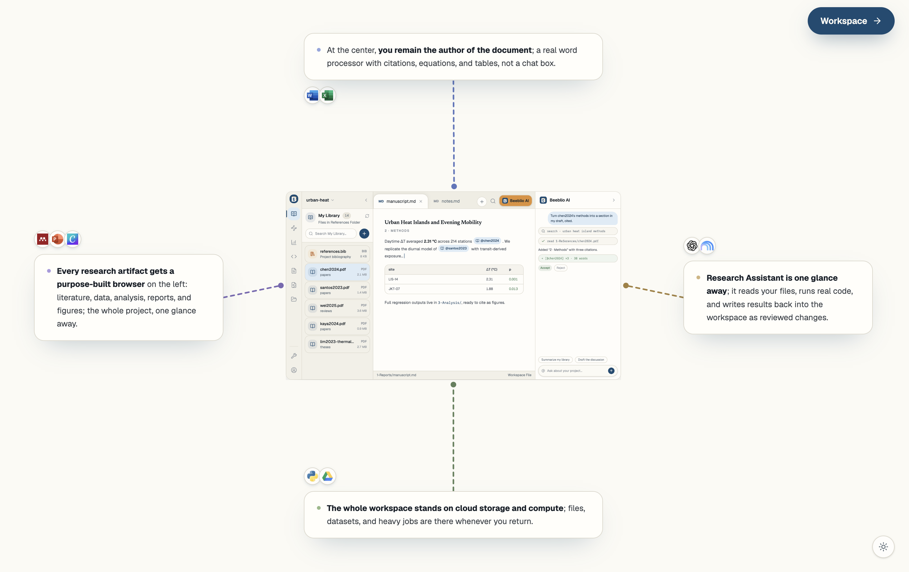
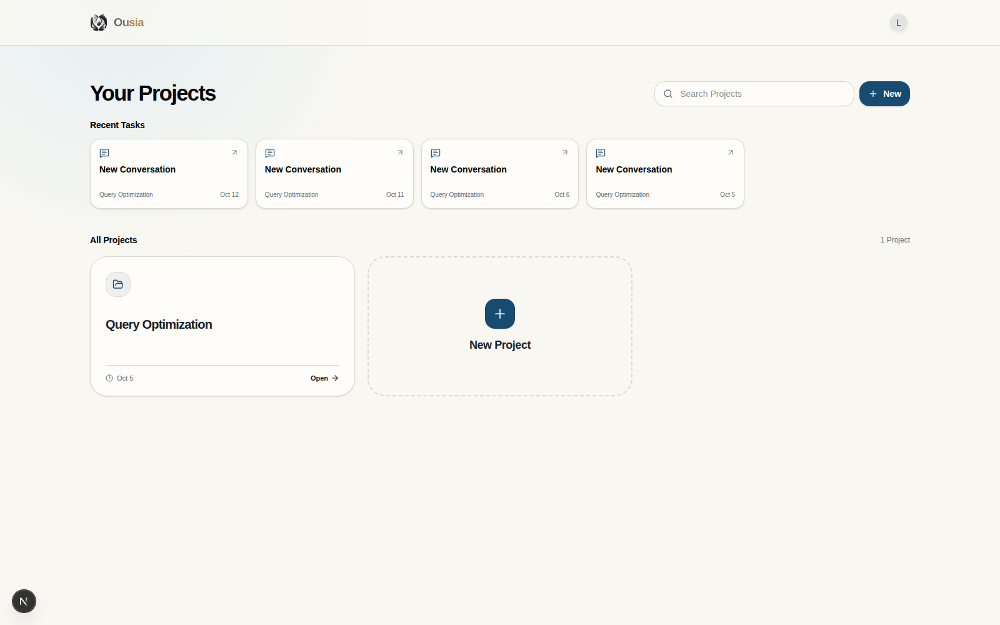
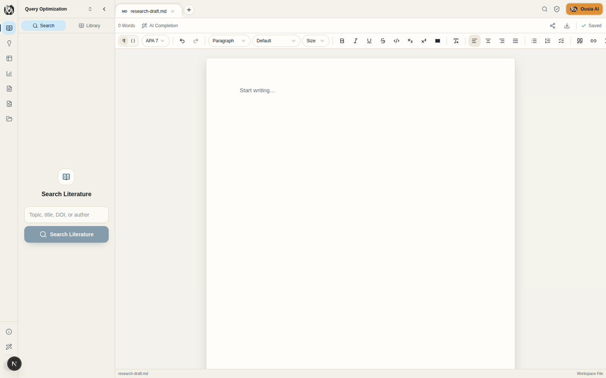
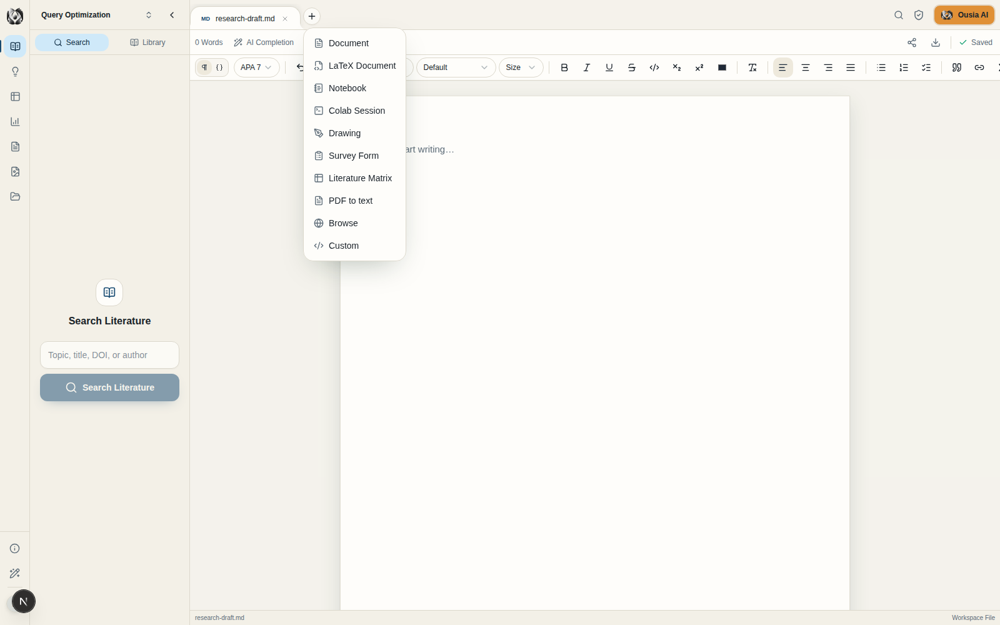

# Ousia

Ousia is a full-stack AI research workspace. It collaborates with you and works directly in your folders & documents. The Next.js interface and Eve agent run locally on your computer, and each project points to an existing folder.

This is intended for a single trusted user on one computer.



## Screenshots







Regenerate these with the app running: `node scripts/screenshots.mjs`.

## What you can do

Ousia brings writing, an AI research assistant, and your project files into one workspace:

- **Write with your sources beside you.** The [document editor](./app/%5BprojectId%5D/_components/editors/tiptap-document-editor.tsx) supports rich Markdown editing, tables, math, images, inline citations, and a generated bibliography. The [LaTeX editor](./app/%5BprojectId%5D/_components/editors/latex-editor.tsx) pairs a source pane with a live PDF preview compiled by Tectonic. Search for literature or insert a citation from the editor, and use document review and sentence suggestions while you write. Export finished work as DOCX, citation-aware DOCX, LaTeX, or portable Markdown.
- **PDF to text.** Use the **+** menu's **PDF to text** action to extract a PDF's text with PyMuPDF. The PDF opens beside its extracted `.pdf.txt` companion in a split view, with the text editable and saved like any other file.
- **Notebooks: local and Colab.** Create a Jupyter notebook (`.ipynb`) from the **+** menu and run it with your **local Python kernel** via Jupyter/nbconvert, or switch the runtime to **Colab**: connect your Google account, start a CPU/GPU/TPU runtime, and run the notebook against it. Outputs are written back into the notebook file, and you can open the running session in Colab.
- **Work with an agent in the same project.** The [chat](./app/_components/agent-chat.tsx) can use the open file, `@`-mentioned files, uploaded files, and selected passages as context. The [Eve agent](./agent/) can search literature and the web, inspect and edit project files, update bibliographies and literature matrices, and run local Bash or Python workflows. Conversations are saved per project so you can return to earlier work.
- **Keep the research organized.** The [workspace rail](./app/%5BprojectId%5D/_components/project-layout-ui.tsx) combines a searchable [file explorer](./app/%5BprojectId%5D/_components/file-explorer.tsx) with [literature search and library](./app/%5BprojectId%5D/_components/literature-panel.tsx). Browse references, data, analysis, reports, and figures in the [artifact views](./app/%5BprojectId%5D/_components/research-artifact-browser.tsx); upload files, create folders and research artifacts, and open them alongside the chat.
- **Search literature across databases.** Literature search runs on [findpapers](https://github.com/jonatasgrosman/findpapers) (arXiv, OpenAlex, PubMed, Semantic Scholar) with automatic deduplication. Open-access PDFs download into `1-References/` (resolved through OpenAlex/Unpaywall, publisher `citation_pdf_url`, and repositories like Zenodo) and open in the PDF viewer.
- **Browse the web in a tab.** The **+** menu's **Browse** action opens a page in a tab using server-side Chrome headers and a sandboxed view, with an address bar, reload, and open-in-browser.
- **Bring your own models.** Connect **ChatGPT (Codex login)**, **OpenCode Zen**, **OpenCode Go**, and **OpenRouter** under **AI Providers**, then pick the model per chat from the composer's model picker.

The project [session page](./app/%5BprojectId%5D/%5B%5B...sessionId%5D%5D/page.tsx) connects the workspace to a new or saved conversation. Your project remains an ordinary folder on disk, so files you create or edit in Ousia are available to your other tools.

## Requirements

- Node.js 24 and pnpm 11
- An OpenRouter API key and model ID for the agent
- Bash and Python 3 for local agent commands and analysis
- Optional: Tectonic for the LaTeX document's live PDF preview
- Optional: [findpapers](https://github.com/jonatasgrosman/findpapers) for multi-database literature search — run `bash scripts/findpapers/install.sh`
- Optional: [PyMuPDF](https://pymupdf.readthedocs.io) for the **PDF to text** tool — run `bash scripts/pdf/install.sh`
- Optional: Jupyter (`pip install jupyter nbconvert ipykernel`) for running notebooks with the local Python kernel
- Optional: the Google Colab CLI (`uv tool install google-colab-cli`) and a Google account for Colab notebook sessions
- Optional: LibreOffice (`soffice`) for agent-assisted Office-to-PDF conversion; other command-line tools and Python packages for the workflows you want to run

The folder picker uses macOS's native chooser, or `zenity`/`kdialog` on Linux. On other systems, enter an existing absolute folder path in the project form.

## Run locally

```bash
pnpm install
cp .env.example .env.local
# Optional: set OPENROUTER_API_KEY and OPENROUTER_MODEL_ID in .env.local,
# or connect providers in the app under AI Providers (see Configuration).
pnpm dev
```

Open [http://127.0.0.1:3000](http://127.0.0.1:3000). The root URL redirects to `/workspace`. `pnpm dev` creates `.ousia/` if needed, applies SQLite migrations, and starts both the Next.js UI and the Eve agent. They listen on `127.0.0.1:3000` and `127.0.0.1:2000` respectively.

Choose **Link Project Folder** to select a folder. You can also paste its absolute path. Ousia stores the resolved path in SQLite and works with the files in place. On linking, it adds any missing canonical files & folders: `1-References/`, `2-Data/`, `3-Analysis/`, and `4-Reports/` folders, plus `1-References/references.bib` and `3-Analysis/literature-matrix.matrix`. Existing files are preserved. Agent file tools display the folder as `/workspace`; agent shell commands run on your computer with that folder as the working directory. `$OUSIA_PROJECT_DIR` contains its absolute path.

## Deploy with Docker

```bash
docker build -t ousia .
docker run --rm -p 3000:3000 \
  -v "$HOME/ousia-data:/app/.ousia" \
  -v "$HOME/Documents:/projects" \
  -e OPENROUTER_API_KEY=... -e OPENROUTER_MODEL_ID=... \
  ousia
```

Open [http://127.0.0.1:3000](http://127.0.0.1:3000). The image bundles the Next UI, the Eve agent, and the optional research toolchains (findpapers, PyMuPDF, Jupyter, Tectonic). Link a project folder from a mounted path such as `/projects/my-research`, and persist `.ousia/` so the database, secrets, and provider keys survive.

CI builds and publishes the image to GitHub Container Registry on every push to `main` and on `v*` tags (`ghcr.io/<owner>/<repo>`); see [`.github/workflows/docker.yml`](./.github/workflows/docker.yml).

> The agent runs Bash/Python inside the container, so it can only see paths mounted into it, and desktop features (native folder picker, opening external apps) are unavailable.

## Configuration

Open **AI Providers** from the account menu (bottom of the workspace rail) to connect the models the chat agent can use. Keys are stored in `.ousia/providers.json` (mode `0600`) on this computer:

- **ChatGPT** — sign in with your ChatGPT subscription through the Codex CLI. Choose **Connect ChatGPT**, open the shown link, and enter the one-time code.
- **OpenCode Zen** — paste an API key from [opencode.ai/auth](https://opencode.ai/auth) to chat with Zen models.
- **OpenCode Go** — paste an API key for a Go or Go Plus subscription to chat with its open coding models.
- **OpenRouter** — paste an API key from [openrouter.ai/keys](https://openrouter.ai/keys).

The chat composer has a model picker listing every model from the connected providers and the ChatGPT subscription. The last choice is remembered, and a default can be set from the same dialog.

Environment variables remain supported as a fallback. Without a connected provider the main agent needs `OPENROUTER_API_KEY`, `OPENROUTER_MODEL_ID`, and `OPENROUTER_MODEL_CONTEXT_WINDOW_TOKENS`. Set the context window to the token limit of the OpenRouter model you selected. Copy [`.env.example`](./.env.example) for all settings:

| Setting | Used for |
| --- | --- |
| `OPENROUTER_MODEL_ID_LITE` | Lightweight tasks such as conversation titles and sentence suggestions |
| `OPENROUTER_REQUEST_TIMEOUT_MS` | Optional limit for one agent model request, in milliseconds; unset means no time limit. Agent turns have no fixed time limit. |
| `OPENROUTER_MODEL_ID_REVIEW` | Document review; falls back to the main model |
| `OPENROUTER_VISION_MODEL_ID` | Image analysis; falls back to the main model if it supports vision |
| `GOOGLE_API_KEY`, `GOOGLE_TRANSCRIPTION_MODEL_ID` | Google key and selected transcription model for audio transcription |
| `GOOGLE_KNOWLEDGE_EMBEDDING_MODEL_ID`, `GOOGLE_KNOWLEDGE_QUERY_MODEL_ID` | Selected Google models for creating and querying Knowledge stores |
| `MONID_API_KEY`, `BRAVE_SEARCH_API_KEY` | Optional research and web tools |
| `CROSSREF_MAILTO` | Contact address for scholarly metadata requests |
| `PUBLIC_TUNNEL_ORIGIN` | Public HTTPS origin of a tunnel to the local UI, used for Office Online previews and share links |

Literature search is powered by [findpapers](https://github.com/jonatasgrosman/findpapers) when its venv is installed (`bash scripts/findpapers/install.sh`), querying arXiv, OpenAlex, PubMed, and Semantic Scholar in parallel with automatic deduplication. `OPENALEX_API_KEY`, `NCBI_API_KEY`, `SEMANTIC_SCHOLAR_API_KEY`, `IEEE_API_KEY`, `SCOPUS_API_KEY`, `WOS_API_KEY`, and `CROSSREF_MAILTO` raise rate limits and unlock additional databases; without findpapers the built-in OpenAlex/Crossref/PubMed providers are used.

The application has one local user and no browser login or accounts checks. Keep the servers bound to loopback: the agent's Bash tool uses your computer's own environment and can access files outside a project folder through shell commands.

## Where data lives

- **Project files:** Your linked folders. Browser uploads, downloads, and agent file operations use local filesystem routes.
- **Application data:** `.ousia/ousia.sqlite` stores projects, conversation state, knowledge metadata, and share records. Schema migrations are in [`drizzle/`](./drizzle/).
- **Internal secret:** `.ousia/agent-secret` is generated automatically for the local UI-to-agent connection.
- **Agent compute:** Eve runs Bash and Python on the host (or in the container when using the Docker image). No separate database server is required. The bundled `ousia_research` Python helper is available to agent commands; other Python packages come from your local environment.

Ousia still calls external model and research APIs when those features are used. Back up both your project folders and `.ousia/` if you need to preserve files and conversation history.

## Documents

The Markdown editor can export DOCX, DOCX with Mendeley or Zotero citations, LaTeX, and portable Markdown. Office files in the workspace open in Microsoft's read-only Office Online viewer. Because Microsoft fetches the file itself, local previews require a public HTTPS tunnel to `127.0.0.1:3000` and its base URL in `PUBLIC_TUNNEL_ORIGIN`; restart `pnpm dev` after changing it. The Share button also uses this origin for links that others can open. Keep the tunnel running while using either feature. The tunnel exposes the app, and Office previews send the viewed file to Microsoft's service.

To make a PDF, export DOCX and convert it with your local document software or ask the agent to do it. LibreOffice is optional for that local conversion; it is not used by the current Office file viewer.

The Share button creates a public link for a file. When `PUBLIC_TUNNEL_ORIGIN` is set, the link uses that tunnel even if you opened Ousia through localhost. Keep the app and tunnel running for others to view shared files or submit shared forms; form responses are saved in the project folder.

## License

Released under the [PolyForm Noncommercial License 1.0.0](./LICENSE.md). Noncommercial use only.

## Development commands

```bash
pnpm typecheck
pnpm lint
pnpm build
pnpm build:eve
pnpm db:migrate
pnpm start        # run the built UI + agent (migrations, boxed on 127.0.0.1:3000/:2000)
```
